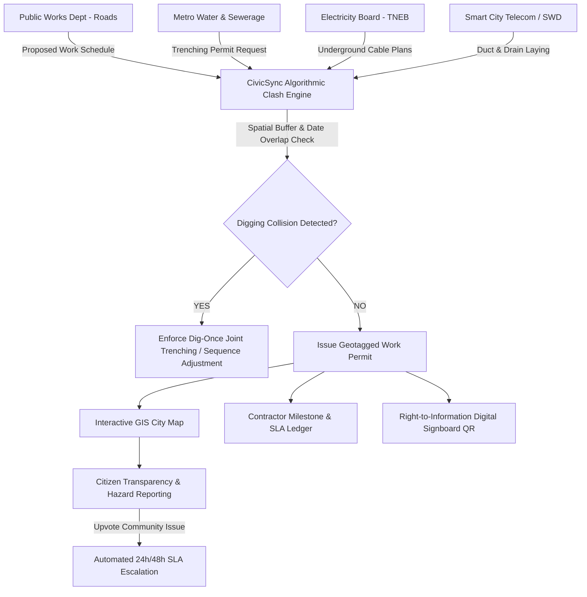

# 🏛️ CivicSync — Municipal Public Works Coordination & Citizen Transparency Platform

> **Hackathon Track:** CivicTech — *Improving Transparency and Coordination in Public Works Projects*  
> **Event:** 24-Hour Web Development Hackathon • IIITDM Kancheepuram  
> **Repository:** [https://github.com/Abrar-908/CivilTech](https://github.com/Abrar-908/CivilTech)  
> **🌐 Live Deployment:** [https://abrar-908.github.io/CivilTech/](https://civicsync-public-works.onrender.com)  
> **🎥 Video Demonstration (2–5 Mins):** [Demo Video Link](https://github.com/Abrar-908/CivilTech)  

---

## 📌 Problem Statement & Context

In cities and municipalities across India and worldwide, residents constantly witness newly paved roads being dug up just weeks later by another utility provider:
1. **Siloed Municipal Departments:** Public Works (Roads), Water Supply & Sewerage (CMWSSB), Electricity Distribution (TNEB), Stormwater Drainage (SWD), and Telecom operate in isolation with zero unified spatial-temporal calendar.
2. **Taxpayer Fund Wastage:** Roads are resurfaced at great expense, only to be sliced open within days for water pipelines or electric trenching, destroying fresh bitumen and wasting crores in public funds.
3. **Ghost Roadwork & Unaccountable Delays:** Contractors abandon sites or exceed deadlines without explanation; milestone payments are disbursed without verifiable physical proof.
4. **Information Vacuum for Citizens:** Residents are left in the dark regarding who is digging, what work order is active, who the site engineer is, when the road will reopen, or how to navigate around traffic chokepoints.
5. **No Early Feedback Loop:** Uncovered 7-foot pits, missing reflective barricades, and broken water pipes go unnoticed by authorities until accidents happen.

---

## 💡 The CivicSync Solution

**CivicSync** is an end-to-end municipal governance and public transparency platform that connects **Citizens**, **Department Engineers**, **Contractors**, and **City Commissioners** into a single synchronized digital ecosystem.



---

## ✨ Key Features & Architectural Highlights

### 1. ⚡ Inter-Department Clash Detection & "Dig-Once" Policy Engine
* **Spatial-Temporal Collision Matrix:** Analyzes proposed excavation coordinates against scheduled road resurfacings within 180 days.
* **Proactive Clash Prevention:** Catches situations where utility trenching is planned immediately after road paving (e.g., *Velachery Bypass Bitumen Paving vs. Metro Water 450mm Feeder Trenching*).
* **One-Click Algorithmic Resolutions:**
  * **Joint Utility Trenching:** Merges contracts so water pipes and cables are laid concurrently before asphalt is poured (saving **₹18.5+ Lakhs** per corridor).
  * **Sequence Adjustment:** Automatically pushes road resurfacing to execute strictly *after* deep utility trenching.
  * **Digging Moratorium:** Enforces a 2-year excavation freeze on newly resurfaced streets.
* **"What-If" Pre-Approval Excavation Simulator:** Allows departmental officers to test prospective projects against the city's active calendar.

### 2. 🗺️ Interactive GIS Public Works Map
* Powered by **Leaflet & CartoDB** GIS basemaps with styled SVG departmental markers.
* **Color-Coded Municipal Agencies:**
  * 🔵 Highways & PWD Roadways
  * 🔷 Metro Water & Sewerage
  * 🟡 Electricity Board (TNEB)
  * 🟢 Stormwater Drainage
  * 🟣 Smart City Telecom
  * 🔴 Pulsing Conflict / Clash Zones
* **Live Project Dossier Panel:** Displays physical progress %, road name, ward, contractor emergency contact, budget breakdown, and live detour advice.

### 3. 📢 Citizen Transparency & Community Grievance Portal
* **"Know Your Street" Explorer:** Instant lookup of roadwork in any ward or neighborhood.
* **Geotagged Hazard Reporting:** Citizens submit reports with GPS coordinates, photos, severity level, and hazard category (Unbarricaded Pit, Blocked Footpath, Pipe Burst, Stalled Site).
* **Crowdsourced SLA Escalation:** Citizens can upvote issues in their ward. Crossing 25 upvotes automatically triggers high-priority escalation to the Zonal Commissioner.
* **Before/After Resolution Transparency:** Public view of contractor remediation photos and assigned officer notes.

### 4. 🏗️ Contractor Milestone & Budget Accountability Ledger
* **Geo-Fenced Proof of Work:** Taxpayer funds are released strictly against timestamped, GPS-verified photographic evidence per milestone.
* **Automated Liquidated Damages (Delay Penalties):** Delays past SLA automatically incur calculated financial deductions from contractor disbursements.

### 5. 📜 Right-to-Information Digital Municipal Disclosure Signboard (QR)
* Emulates the physical site notice boards required by law.
* Generates a digital disclosure with work order registration, sanctioned budget, executive engineer phone number, penalty clause, and QR code to view live status on smartphones.

### 6. 📊 Zonal Executive Analytics & Taxpayer Savings
* Real-time metrics: Taxpayer capital saved via avoided repeated excavations (**₹1.85 Crores** this fiscal year).
* Ward-by-ward coordination leaderboard and compliance scoring.
* **One-Click Audit Export:** Generates an official municipal transparency audit report in JSON format.

---

## 🛠️ Technology Stack

| Layer | Technologies Used |
|---|---|
| **Frontend Framework** | React 19, Vite |
| **GIS & Mapping** | Leaflet, React-Leaflet, CartoDB Voyager Tiles |
| **Icons & Micro-interactions** | Lucide React, Canvas Confetti |
| **Styling & Design System** | Pure Vanilla CSS (Variables, Glassmorphism, Responsive Grid, Dark Mode) |
| **State & Data Store** | Synchronized React State with simulated Municipal Civic Database |

---

## 🚀 Getting Started Locally

### Prerequisites
* **Node.js** (v18.x or newer)
* **npm** (v9.x or newer)

### Installation & Run

1. Clone or navigate to the project directory:
   ```bash
   cd CivilTech
   ```

2. Install dependencies:
   ```bash
   npm install
   ```

3. Launch the development server:
   ```bash
   npm run dev
   ```

4. Open your browser at:
   ```text
   http://localhost:5173
   ```

5. Build for production:
   ```bash
   npm run build
   ```

---

## 🏆 Hackathon Evaluation Alignment

* **Innovation (20%):** Introduces proactive algorithmic clash detection and "Dig-Once" joint trenching rather than passive status displays.
* **Technical Implementation (35%):** Full-featured React SPA with custom Leaflet GIS mapping, dynamic conflict resolution engine, geotagged citizen portal, and contractor SLA ledger.
* **Feasibility (20%):** Modeled directly on the organizational structures of metropolitan corporations (PWD, Metro Water, TNEB, Smart Cities Mission).
* **Video Presentation & Usability (15%):** Intuitive persona switching (Citizen, Dept Engineer, City Commissioner), high-contrast accessible UI, and real-time visual feedback.
* **Deployment (10%):** Production-ready build with zero external build dependencies.

---

*Made with ❤️ for IIITDM Kancheepuram Web Development Hackathon 2026*
